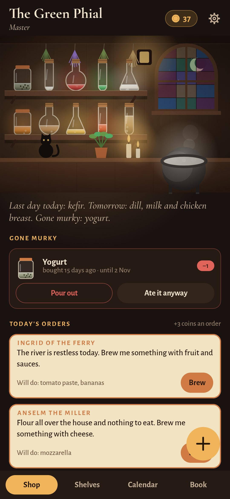
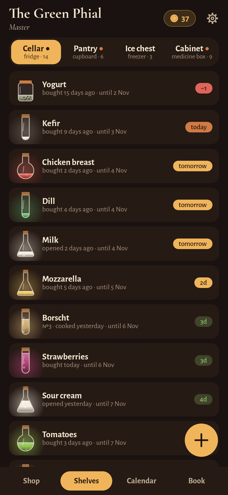
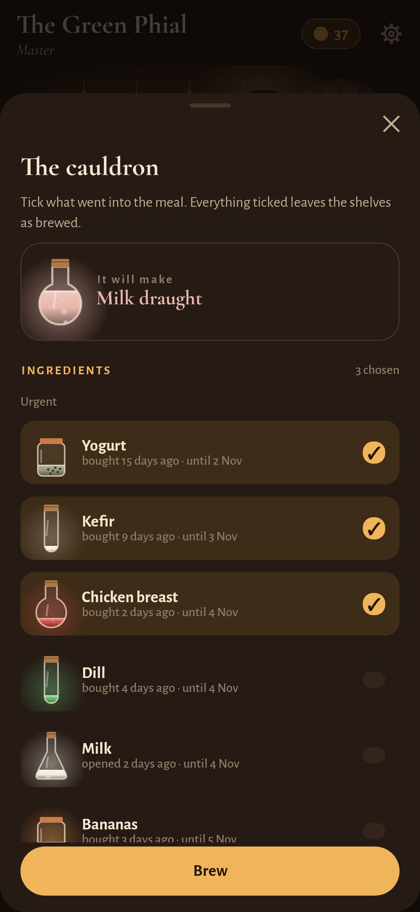
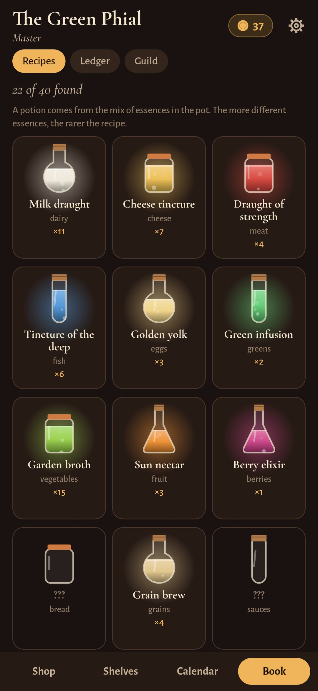

<div align="center">


# Apothecary

### Your fridge, cupboard, freezer and medicine box as a small potion shop

*Every product is a bottle of essence that glows while it's fresh and dims as its date comes near. Cook a meal and you brew a potion; mix essences and new recipes open in the book; regulars come in each morning for exactly what is about to go to waste. Free, no ads, no accounts, works offline.*

[](https://github.com/bigdevwhale/apothecary/actions/workflows/android.yml)
[](https://github.com/bigdevwhale/apothecary/releases/latest)


[](LICENSE)

**English** · [Русский](README.ru.md) · [Changelog](CHANGELOG.md)

   

**[Download APK](https://github.com/bigdevwhale/apothecary/releases/latest/download/Apothecary.apk)** · Android 9+

</div>

---

## Shelves and dates

- **Four places.** The cool cellar (the fridge), the pantry (the cupboard), the ice chest (the freezer) and the cabinet behind the counter (medicines and vitamins).
- **The real deadline.** It's the date on the package or "opened + the days it keeps open", whichever comes first. Milk dated two weeks ahead lasts three days once opened, and the bottle shows it.
- **A guide of about 170 products.** Type "kef…" and it fills in the category, the shelf, the date and how long it keeps open. Everything can be changed by hand.
- **The ice chest** stops the clock and starts a new, longer one. Taken out to thaw, a thing keeps a day or two.
- **Leftovers get a number** to write on the lid, so you never guess which soup it is.

## The game

- **The cauldron.** Tick what went into the meal and see which potion it will make before you brew. 40 recipes come from the mix of essences; five essences make the Grand Elixir, three things saved on their last day make the Potion of the Last Hour.
- **Customers.** Six regulars (the herbalist, the miller, a retired knight, the clockmaker, a bard and the ferrywoman) come each morning and ask for what is about to be lost. The note says which of your bottles will do.
- **Coins and the shop.** Potions bring coins, more for things saved on their last day and for orders. They buy candles, herbs, a cat, an owl, a stained-glass window, a copper cauldron, a painted sign…
- **The guild.** From Apprentice to Guildmaster, by potions brewed and how little was poured out in the last 30 days.

## Order and numbers

- **The shop's summary** names what's on its last day and what has gone murky, with "pour out" and "ate it anyway" right there.
- **The calendar** shows which day each ingredient runs out, and what was brewed or poured out on past days.
- **The ledger:** brewed, saved on the last day, poured out, the money lost, the share of loss, days without loss, eight weeks in bars, what goes to waste most, favourite potions.
- **The night audit** once a week: walk the shelves and mark what's no longer there.
- **The morning bell** names what's on its last day today and tomorrow, and medicines a month or a week from their date. Silent when nothing is due.

## The medicine box

- **The guild's kit:** fever, pain, antiseptic, bandages, sorbent, allergy, heartburn, thermometer. The cabinet shows what's missing or out of date.
- **Drops and syrups** keep their own short life once opened; medicines warn a month ahead.
- **Vitamin courses** count the pills left and the days they last.
- **Expired medicines** go to a pharmacy collection box, not the bin.

Everything stays on the phone. The app needs no internet.

## Build

```
./gradlew assembleDebug                 # app.apothecary.dev
./gradlew assembleDebug -Pdemo          # app.apothecary.demo with a shop ten weeks old
./gradlew testDebugUnitTest -Prender --tests '*Render*' && python tools/shots.py
```

MIT licence.
