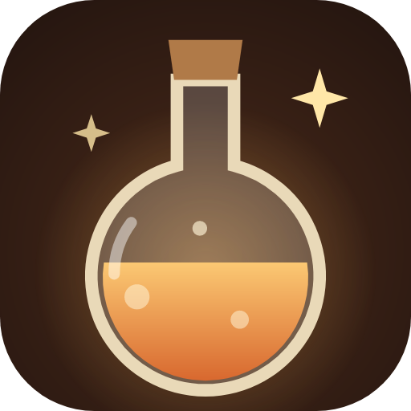
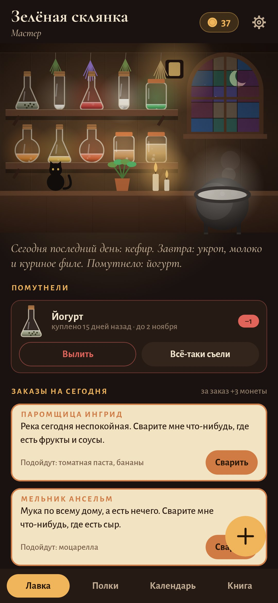
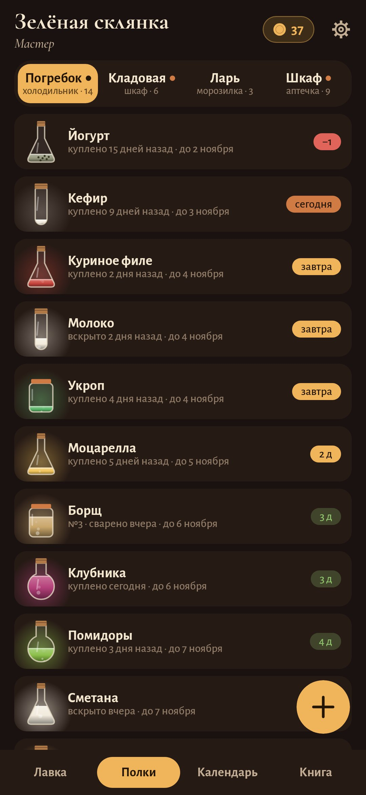
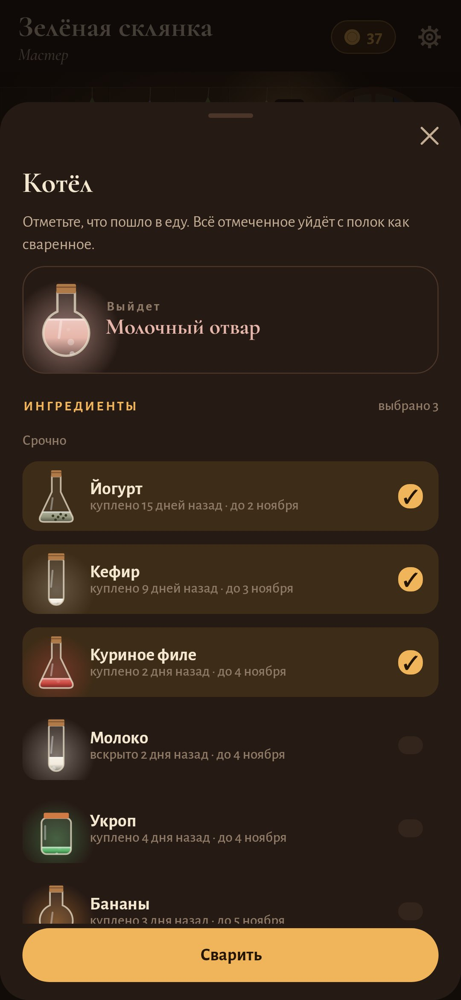
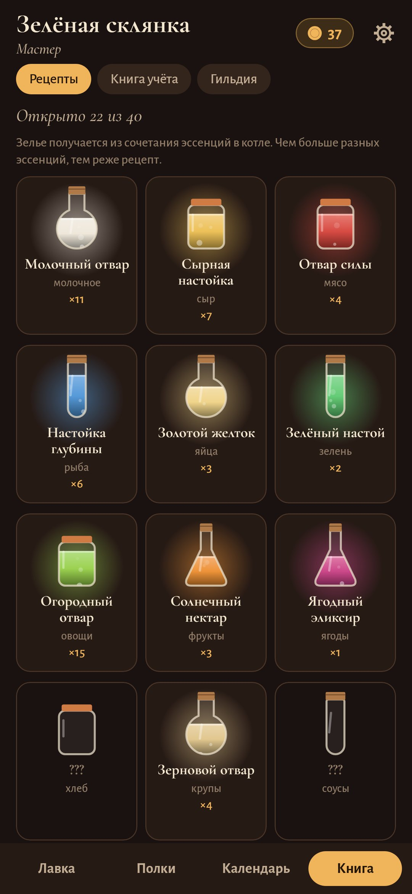

<div align="center">



# Зельевар

### Холодильник, шкаф, морозилка и аптечка как маленькая лавка зелий

*Каждый продукт — колба с эссенцией. Она светится, пока продукт свежий, и тускнеет, когда срок подходит к концу. Приготовили еду — сварили зелье. Новые сочетания открывают рецепты в книге, а по утрам приходят покупатели и просят как раз то, что вот-вот пропадёт. Бесплатно, без рекламы и аккаунтов, работает без интернета.*

[](https://github.com/bigdevwhale/apothecary/actions/workflows/android.yml)
[](https://github.com/bigdevwhale/apothecary/releases/latest)


[](LICENSE)

[English](README.md) · **Русский** · [Изменения](CHANGELOG.md)

   

**[Скачать APK](https://github.com/bigdevwhale/apothecary/releases/latest/download/Apothecary.apk)** · Android 9+

</div>

---

## Полки и сроки

- **Четыре места.** Погребок (холодильник), кладовая (шкаф с запасами), ледяной ларь (морозилка) и шкаф за прилавком (лекарства и витамины).
- **Настоящий срок.** Это дата на упаковке или «вскрыто плюс сколько дней годно открытым», смотря что раньше. Молоко с датой через две недели после вскрытия живёт три дня, и колба это покажет.
- **Справочник примерно на 170 продуктов.** Начните вводить «кеф…», и он сам подставит категорию, полку, срок и сколько продукт хранится открытым. Всё можно поправить вручную.
- **В ледяном ларе** старый срок замирает, и начинается новый, длиннее. Если достать продукт оттаивать, у него останется день-два.
- **Готовой еде** приложение даёт номер. Напишите его на крышке, и больше не придётся гадать, что это за суп.

## Игра

- **Котёл.** Отметьте, что пошло в еду, и ещё до варки увидите, какое зелье получится. Рецептов 40, и зависят они от сочетания эссенций. Из пяти разных эссенций выходит Великий эликсир, а из трёх продуктов, спасённых в последний день, — Зелье последнего часа.
- **Покупатели.** По утрам заходят шестеро постоянных: травница, мельник, старый рыцарь, часовщик, бард и паромщица. Они просят то, что вот-вот пропадёт, а в записке видно, какие из ваших колб подойдут.
- **Монеты и лавка.** За зелья дают монеты, а за спасённое в последний день и за выполненный заказ — больше. На них покупаются свечи, пучки трав, кот, сова, витраж, медный котёл, вывеска и другое.
- **Гильдия.** Звания от ученика до магистра. Они зависят от числа сваренных зелий и от того, сколько вылито за последние 30 дней.

## Порядок и цифры

- **Сводка лавки** называет, у чего сегодня последний день и что помутнело. Тут же есть кнопки «Вылить» и «Всё-таки съели».
- **Календарь** показывает, в какой день у какого продукта кончается срок и что было сварено или вылито раньше.
- **Книга учёта:** сколько сварено, сколько спасено в последний день, сколько вылито и на какую сумму, доля потерь, дни без потерь, восемь недель на графике, что пропадает чаще всего, любимые зелья.
- **Ночная ревизия** раз в неделю: пройдитесь по полкам и отметьте, чего уже нет.
- **Утренний колокольчик** скажет, у чего последний день сегодня и завтра и какие лекарства истекают через месяц или неделю. Если ничего не горит, он молчит.

## Аптечка

- **Набор гильдии:** от жара, от боли, антисептик, бинт и пластыри, сорбент, от аллергии, от изжоги, термометр. В шкафу видно, чего не хватает и что просрочено.
- **Капли и сиропы** после вскрытия живут недолго, и у них свой срок. О лекарствах приложение предупреждает за месяц.
- **Курсы витаминов:** приложение считает, сколько таблеток осталось и на сколько дней их хватит.
- **Просроченные лекарства** предлагается сдать в аптеку с контейнером для сбора, а не выбросить.

Всё хранится только на телефоне. Интернет приложению не нужен.

## Сборка

```
./gradlew assembleDebug                 # app.apothecary.dev
./gradlew assembleDebug -Pdemo          # app.apothecary.demo с лавкой, которой десять недель
./gradlew testDebugUnitTest -Prender --tests '*Render*' && python tools/shots.py
```

Лицензия MIT.
